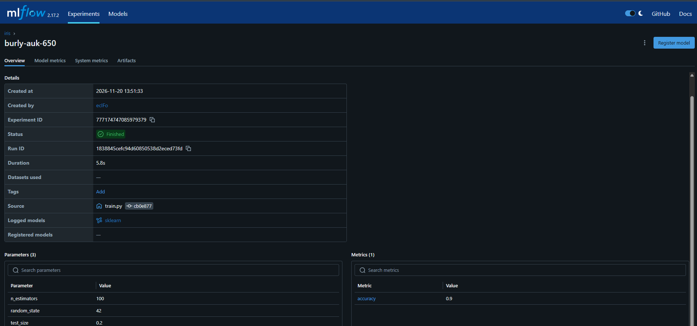
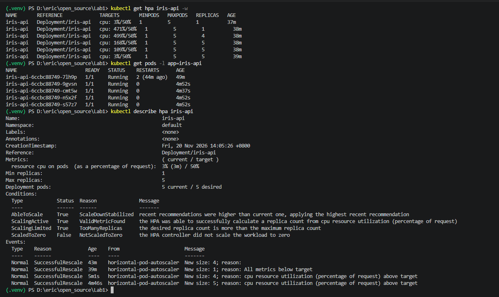

# Lab 1：Your First Model Service on Kubernetes

MLOps Foundations & Cloud Native AI — Week 1 Lab（講義 p.49–52）

用 scikit-learn 訓練 Iris 分類模型並以 MLflow 追蹤實驗，包成 FastAPI 服務、建成 Docker image，部署到本機 kind 叢集，再以 HorizontalPodAutoscaler（HPA）依 CPU 負載自動擴展。

## 架構

```
Developer laptop                                   kind cluster (Kubernetes in Docker)
┌──────────────────────────────┐                  ┌───────────────────────────────────────────┐
│ train.py ──► MLflow          │                  │  Deployment: iris-api                     │
│    │      (params/metrics/   │                  │   ┌─────┐ ┌─────┐ ┌─────┐   ◄── HPA       │
│    ▼       model)            │   kind load      │   │ Pod │ │ Pod │ │ Pod │   cpu 50%       │
│ model.pkl ──► app.py ──► image ─docker-image──► │   └─────┘ └─────┘ └─────┘   1 → 5         │
│               (FastAPI)  iris-api:v1            │        ▲                       ▲          │
│                              │                  │  Service iris-api       metrics-server    │
│ curl / hey ──────────────────┼─port-forward───► │  ClusterIP :80 → 8080                     │
└──────────────────────────────┘                  └───────────────────────────────────────────┘
```

## 檔案說明

| 檔案 | 說明 |
|---|---|
| [train.py](train.py) | 訓練 RandomForest，用 MLflow 記錄參數、accuracy 與模型，輸出 `model.pkl` |
| [app.py](app.py) | FastAPI 服務：`POST /predict`、`GET /healthz` |
| [Dockerfile](Dockerfile) | 服務的容器映像（`iris-api:v1`） |
| [requirements.txt](requirements.txt) | 本機訓練環境（含 MLflow） |
| [requirements-serve.txt](requirements-serve.txt) | 容器內的服務環境（scikit-learn 版本與本機相同） |
| [k8s/deployment.yaml](k8s/deployment.yaml) | Deployment（resource requests/limits、readiness/liveness probe）＋ Service |
| [k8s/hpa.yaml](k8s/hpa.yaml) | HPA：CPU 50%，1 → 5 個副本 |
| [k8s/metrics-server-patch.json](k8s/metrics-server-patch.json) | 讓 metrics-server 在 kind 上可用的 patch |
| [sample.json](sample.json) | 測試用的請求內容 |
| [screenshots/](screenshots/) | MLflow run 與 HPA scaling 的執行結果截圖 |

---

## 0. 安裝工具（Windows，只需做一次）

在 PowerShell 執行：

```powershell
winget install Docker.DockerDesktop      # 安裝後開啟 Docker Desktop，等它顯示 Engine running
winget install Kubernetes.kind
winget install Kubernetes.kubectl
winget install Python.Python.3.12        # MLflow / scikit-learn 目前在 3.12 最穩定
go install github.com/rakyll/hey@latest  # 壓測工具，執行檔在 $env:USERPROFILE\go\bin
```

裝完後**重開 PowerShell**，確認：

```powershell
docker version; kind version; kubectl version --client; py -3.12 --version
& "$env:USERPROFILE\go\bin\hey.exe"      # 有印出 usage 即可
```

> 若 `hey` 找不到，把 `$env:USERPROFILE\go\bin` 加到 PATH，或之後都用完整路徑呼叫。

## 1. 建立本機叢集（Step 1）

```powershell
kind create cluster --name mlops
kubectl cluster-info --context kind-mlops
```

## 2. 訓練模型並用 MLflow 追蹤（Step 2）

```powershell
cd d:\eric\open_source\Lab1
py -3.12 -m venv .venv
.\.venv\Scripts\Activate.ps1             # 若被擋：Set-ExecutionPolicy -Scope CurrentUser RemoteSigned
pip install -r requirements.txt

python train.py                          # 產生 model.pkl 與 mlruns/
mlflow ui                                # 開 http://localhost:5000
```

📸 **截圖 1**：在 MLflow UI 點進 `iris` 實驗的 run，畫面要能看到 Parameters（`n_estimators`）與 Metrics（`accuracy`），存成 `screenshots/mlflow-run.png`。看完按 `Ctrl+C` 關掉 `mlflow ui`。

## 3. 包成 Docker image 並載入 kind（Step 3）

```powershell
docker build -t iris-api:v1 .
kind load docker-image iris-api:v1 --name mlops
```

（可選）先在本機確認容器能動：

```powershell
docker run --rm -p 8080:8080 iris-api:v1
# 另開一個視窗：Invoke-RestMethod http://localhost:8080/healthz
```

## 4. 部署到 Kubernetes 並測試（Step 4）

```powershell
kubectl apply -f k8s/deployment.yaml
kubectl get pods -w                      # 等到 READY 1/1 後按 Ctrl+C
```

**另開一個 PowerShell 視窗**做 port-forward（要一直開著）：

```powershell
kubectl port-forward svc/iris-api 8080:80
```

回到原本視窗測試（PowerShell 的 `curl` 是別名，請用下列其中一種）：

```powershell
# 方法 A：PowerShell 原生
Invoke-RestMethod -Method Post -Uri http://localhost:8080/predict `
  -ContentType "application/json" -Body (Get-Content sample.json -Raw)

# 方法 B：真正的 curl
curl.exe -X POST http://localhost:8080/predict -H "Content-Type: application/json" --data-binary "@sample.json"
```

預期結果：`{"predictions":[0]}`

## 5. 安裝 metrics-server、設定 HPA 並壓測（Step 5）

### 5-1 安裝 metrics-server

kind 預設沒有 metrics-server，沒有它 HPA 的 TARGETS 會一直是 `<unknown>`。

```powershell
kubectl apply -f https://github.com/kubernetes-sigs/metrics-server/releases/latest/download/components.yaml

# kind 的 kubelet 使用自簽憑證，需加 --kubelet-insecure-tls
kubectl patch deployment metrics-server -n kube-system --type=json --patch-file k8s/metrics-server-patch.json

kubectl rollout status deployment metrics-server -n kube-system
kubectl top pods                         # 約 30–60 秒後有數字即成功
```

> 用 `--patch-file` 而不是 `-p '[...]'`，是因為 Windows PowerShell 5.1 傳 JSON 給外部程式時會吃掉雙引號。

### 5-2 建立 HPA

```powershell
kubectl apply -f k8s/hpa.yaml
# 等同講義的：kubectl autoscale deployment iris-api --cpu-percent=50 --min=1 --max=5
kubectl get hpa iris-api                 # TARGETS 應顯示 cpu: x%/50%
```

### 5-3 壓測並觀察擴展

**視窗 2**（port-forward）保持開著。**開視窗 3** 觀察：

```powershell
kubectl get hpa iris-api -w
```

在**視窗 1** 發動 60 秒、50 併發的壓測：

```powershell
& "$env:USERPROFILE\go\bin\hey.exe" -z 60s -c 50 -m POST -T application/json -D sample.json http://localhost:8080/predict
```

幾十秒內就會看到 HPA 的 REPLICAS 從 1 往上增加（最多 5）。壓測結束後看 Pod 數：

```powershell
kubectl get pods -l app=iris-api
kubectl describe hpa iris-api            # Events 會有 "New size: N; reason: cpu resource utilization..."
```

📸 **截圖 2**：`kubectl get hpa iris-api -w` 顯示 REPLICAS 增加的畫面（建議同時附上 `kubectl get pods` 看到多個 Pod），存成 `screenshots/hpa-scaling.png`。

> 補充：`kubectl port-forward` 只會連到其中一個 Pod，所以新開的 Pod 不會分到流量。HPA 仍會依平均 CPU 使用率擴展，不影響本 Lab 的結果。壓測停止約 5 分鐘後，HPA 會再縮回 1 個副本。

## 6. 清理

```powershell
kubectl delete -f k8s/hpa.yaml -f k8s/deployment.yaml
kind delete cluster --name mlops
```

---

## 執行結果

### MLflow Run



### HPA Scaling


